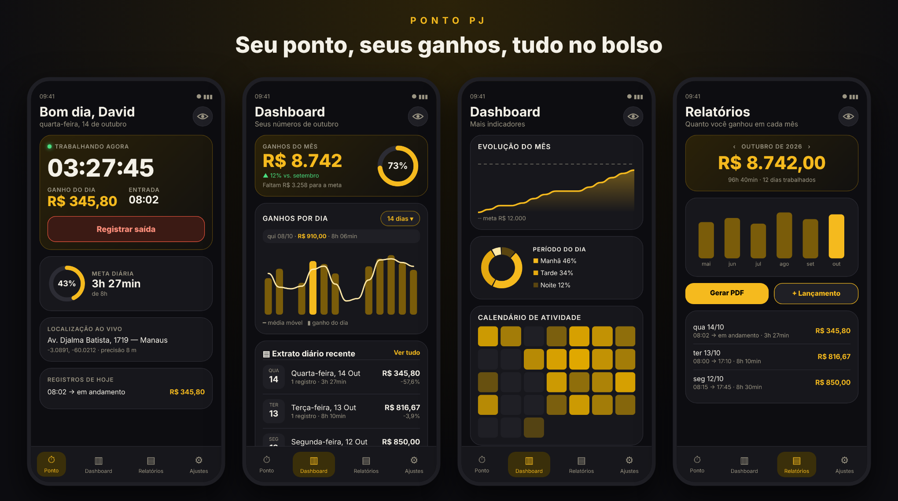
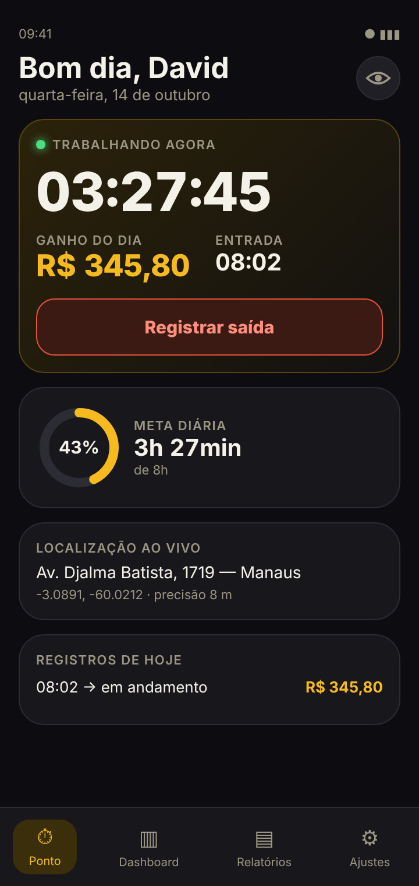
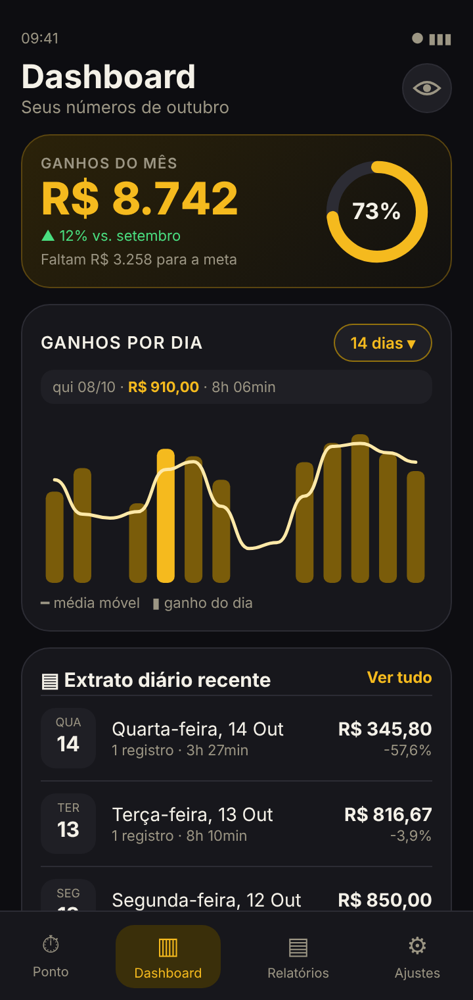
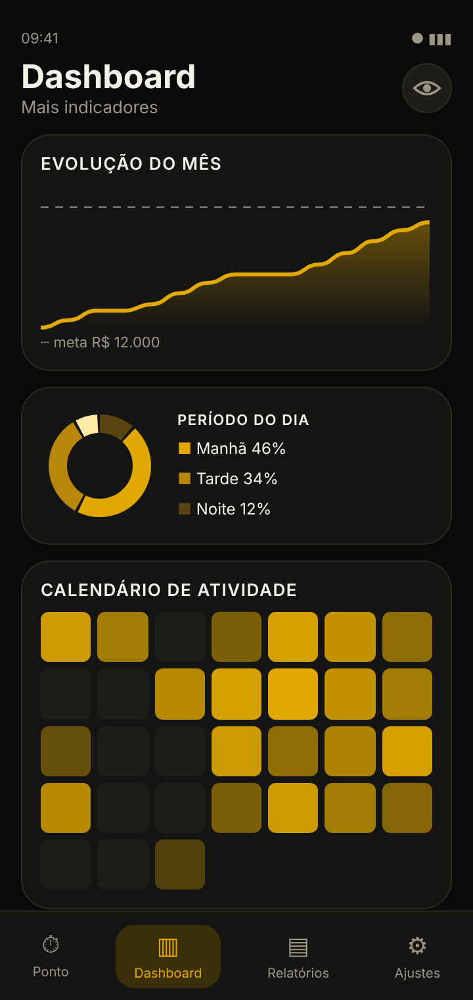
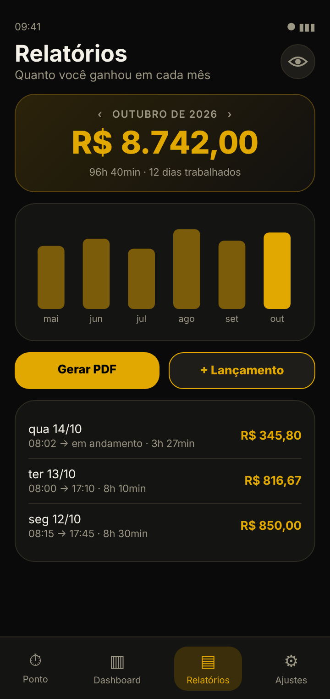
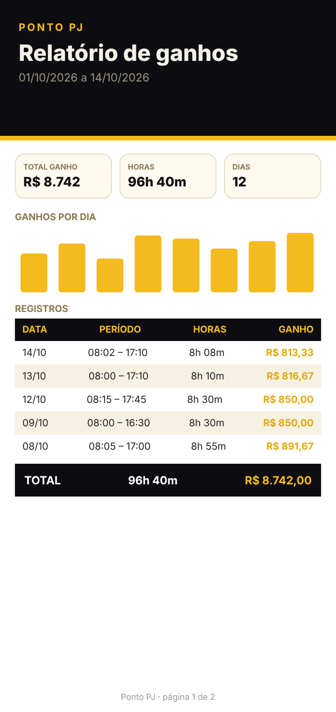
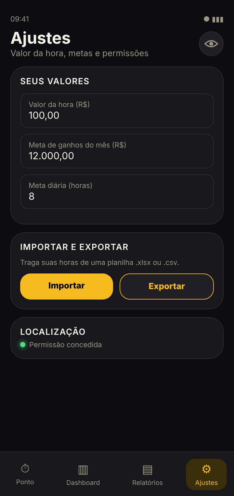

<div align="center">

# ⏱️ Ponto PJ

**Controle de ponto, ganhos por hora e relatórios para quem trabalha como PJ.**

Um toque para registrar entrada e saída, ganhos calculados em tempo real e dashboards para entender o seu mês.




</div>

---

## Sumário

- [Visão geral](#visão-geral)
- [Telas](#telas)
- [O que o app faz](#o-que-o-app-faz)
- [Importar e exportar](#importar-e-exportar)
- [Privacidade](#privacidade)
- [Como gerar o APK](#como-gerar-o-apk)
- [Atualizar o app já instalado](#atualizar-o-app-já-instalado)
- [Tecnologias](#tecnologias)
- [Estrutura do projeto](#estrutura-do-projeto)
- [Próximas ideias](#próximas-ideias)

## Visão geral

Quem trabalha como PJ cobra por hora e precisa saber, sem planilha e sem conta de cabeça, quanto já ganhou no dia e no mês. O **Ponto PJ** resolve isso:

1. Você define o **valor da hora** uma vez, em Ajustes.
2. Toca em **Registrar entrada** quando começa e em **Registrar saída** quando termina. O app mostra o cronômetro e o ganho subindo ao vivo.
3. Ao fim do mês, os **relatórios** e o **dashboard** mostram quanto você recebeu, em quais dias rendeu mais e se vai bater a meta. Se precisar, gera um **PDF** do período.

O visual é preto com amarelo escuro, pensado para leitura rápida e uso com uma mão. Os dados ficam só no celular.

## Telas

> As imagens abaixo são ilustrações do layout, feitas com a mesma paleta e a mesma estrutura do app, com dados de exemplo. Não são capturas de tela reais do aparelho.

| Ponto | Dashboard | Mais gráficos |
|:---:|:---:|:---:|
|  |  |  |
| Entrada/saída com cronômetro, ganho do dia e localização ao vivo | Ganhos do mês, meta e gráfico por dia com filtro e linha de tendência | Evolução do mês, período do dia e calendário de atividade |

| Relatórios | PDF | Ajustes |
|:---:|:---:|:---:|
|  |  |  |
| Ganhos mês a mês, comparativo e detalhe dia a dia | Relatório do período em PDF, salvo em Downloads | Valor da hora, metas, importação e permissões |

## O que o app faz

- **Ponto**: um toque registra entrada e saída, com cronômetro ao vivo e ganho do dia em tempo real.
- **Notificação do ponto**: com o ponto aberto, uma notificação fixa mostra o cronômetro correndo, o ganho do dia, a hora prevista para bater a meta e uma barra de progresso, com o botão **Registrar saída**. Também avisa quando a meta do dia é batida e lembra da saída se o ponto ficar aberto por 12 h. Volta sozinha depois de reiniciar o celular e respeita o olho de ocultar valores. Dá para desligar em Ajustes.
- **Localização em tempo real**: mostra endereço, coordenadas e precisão; grava onde você bateu o ponto.
- **Valor da hora**: definido em Ajustes. Cada registro guarda o valor da época, então mudar depois não altera o histórico.
- **Lançamento manual**: data escolhida no calendário e horários em campos de hora (hh:mm) que só aceitam horas válidas e passam sozinhos da entrada para a saída.
- **Dashboard**:
  - ganhos do mês, meta, projeção e comparação com o mês anterior;
  - ganhos por dia com filtro de 7, 14, 21 dias ou 1 mês (em lista), barras clicáveis e linha suave de média móvel;
  - evolução acumulada do mês (com meta e projeção), rosca de horas por período do dia, calendário de atividade, ganhos por semana e horas por dia da semana;
  - indicadores: sequência de dias, horas extras, maior jornada, dias acima da meta, ritmo para bater a meta, entre outros.
- **Relatórios**: ganhos mês a mês, comparativo de 6 meses, detalhe dia a dia e **PDF** com o período que você escolher (mês, 30 dias, 3 meses, ano ou datas livres). O PDF é salvo em Downloads.
- **Importar de Excel/CSV**: em Ajustes > Importar e exportar. Lê `.xlsx` e `.csv`, reconhece colunas como Data, Entrada, Saída (e Entrada 2 / Saída 2 para quem para no almoço), deixa você conferir as colunas e ver uma prévia antes de importar. Registros que já existem são ignorados. Há um botão para baixar um modelo e outro para exportar seus registros.
- **Painel do dia**: ao tocar numa barra do gráfico, abre o resumo do dia (ganho, comparativo com a média do período, registros, horas, maior registro e composição por registro). Também há os indicadores "Média diária" e "Consistência".
- **Extrato diário recente** (Dashboard): últimos dias trabalhados com ganho do dia e variação em relação ao dia anterior; "Ver tudo" abre os Relatórios.
- **Ocultar valores**: o ícone de olho no topo de cada tela esconde todos os valores em R$ (útil em público). A escolha fica salva.

Os dados ficam só no celular.

## Importar e exportar

1. Em **Ajustes > Importar e exportar**, toque em **Baixar modelo** para ver o formato esperado.
2. Escolha seu arquivo `.xlsx` ou `.csv`. Arquivos `.xls` antigos precisam ser salvos como `.xlsx` antes.
3. Confira se cada coluna está ligada à informação certa e veja a prévia.
4. Toque em **Importar**. O que já existia (mesma entrada e saída) é ignorado.

**Exportar registros** gera um `.csv` com todo o seu histórico, útil como backup.

## Privacidade

- Registros, valor da hora e metas ficam apenas no aparelho (SharedPreferences). Nada é enviado para servidores.
- A localização é usada só enquanto o app está aberto e gravada junto de cada ponto.
- O botão de olho oculta os valores na tela. O PDF e o texto compartilhado saem com os valores reais, porque você os gera de propósito.

## Como gerar o APK

### Opção 1: GitHub Actions (sem instalar nada)

1. Envie esta pasta para um repositório no GitHub (branch `main`).
2. Abra a aba **Actions**, rode **Gerar APK** (ou espere o push disparar).
3. Baixe `PontoPJ-apk` em **Artifacts** e extraia o `app-debug.apk`.

### Opção 2: Android Studio

1. Abra a pasta `PontoPJ` e espere o Gradle sincronizar.
2. Menu **Build > Build Bundle(s) / APK(s) > Build APK(s)**.
3. O arquivo fica em `app/build/outputs/apk/debug/app-debug.apk`.

### Opção 3: linha de comando

Com JDK 17 e o Android SDK: `./gradlew assembleDebug`

## Atualizar o app já instalado

O APK é assinado com a chave fixa `app/pontopj.keystore`. Daqui para frente, instalar uma versão nova por cima mantém os registros.

Se a versão antiga foi assinada com outra chave (por exemplo, uma compilação anterior no GitHub Actions), o Android recusa a atualização por cima. Nesse caso é preciso desinstalar a versão antiga uma única vez, e os registros dela são apagados.

## Tecnologias

| Área | Escolha |
|---|---|
| Linguagem / UI | Kotlin 2.2, Jetpack Compose, Material 3 |
| Android | minSdk 31, compileSdk/targetSdk 36 |
| Build | Gradle 8.14, Android Gradle Plugin 8.13 |
| Armazenamento | SharedPreferences + JSON |
| Localização | `LocationManager` + `Geocoder` (endereço) |
| Gráficos | Desenhados à mão em Canvas (barras, linha suave, área, rosca, calendário) |
| PDF | `android.graphics.pdf.PdfDocument`, salvo via MediaStore |
| Importação | Leitor próprio de `.xlsx` (ZIP + XML) e de `.csv` |
| CI | GitHub Actions |

## Estrutura do projeto

```
app/src/main/java/br/com/pontopj/
├── MainActivity.kt          # navegação por 4 abas e permissões
├── AppViewModel.kt          # estado do app (registros, valor da hora, metas)
├── data/
│   ├── Models.kt            # WorkSession, LocationFix
│   ├── Store.kt             # persistência local
│   ├── Stats.kt             # formatação e agregações (mês, dia, privacidade)
│   ├── ExtraStats.kt        # sequência, horas extras, períodos do dia
│   ├── PdfExporter.kt       # relatório em PDF
│   ├── Importer.kt          # leitura de xlsx/csv e exportação
│   └── Files.kt             # salvar em Downloads
├── location/LocationTracker.kt
└── ui/
    ├── Theme.kt             # paleta preto + amarelo escuro
    ├── Components.kt        # cartões, anéis, botão de olho, linhas de registro
    ├── Charts.kt            # gráficos
    ├── HomeScreen.kt        # Ponto
    ├── DashboardScreen.kt
    ├── ReportsScreen.kt
    ├── SettingsScreen.kt
    └── SessionDialog.kt, PdfDialog.kt, ImportDialog.kt, TimeField.kt
docs/screenshots/            # imagens usadas neste README
```

## Próximas ideias

Veja o [ROADMAP](ROADMAP.md) (login com conta Google e sincronização na nuvem). A referência de visual está em [docs/DESIGN.md](docs/DESIGN.md).
