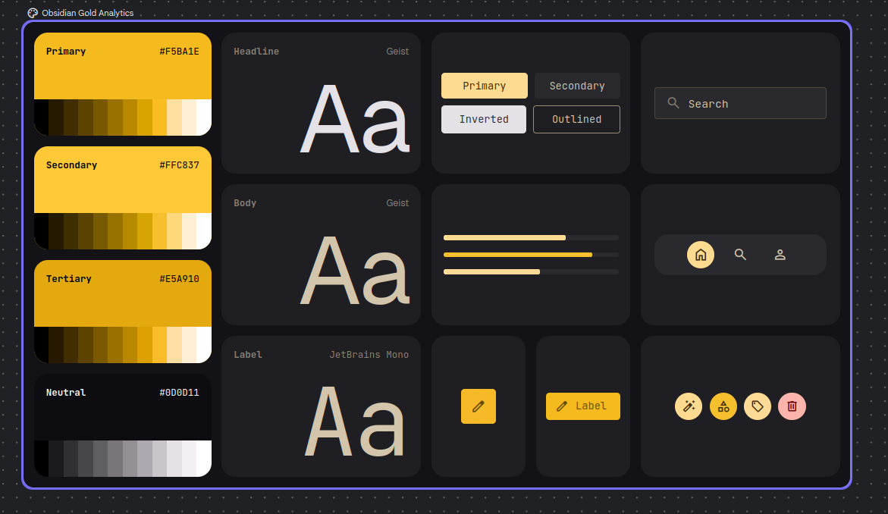

# Design system: Obsidian Gold Analytics

Referência oficial de visual do Ponto PJ. **Todo layout novo ou ajuste de tela deve usar esta paleta e estas fontes.**

## Cores

| Papel | Hex | Uso |
|---|---|---|
| Primary | `#F5BA1E` | Botões principais, destaques, valores importantes, itens ativos |
| Secondary | `#FFC837` | Variação mais clara do dourado (hover, realces, gráficos) |
| Tertiary | `#E5A910` | Dourado mais profundo (apoio, segundas séries de gráficos) |
| Neutral | `#0D0D11` | Fundo do app (preto com leve tom azulado) |

Cada cor tem uma rampa de tons, do preto ao branco (ver imagem). Os neutros vão de `#0D0D11` até um branco levemente rosado, usados para superfícies, bordas e textos.

## Tipografia

| Papel | Fonte |
|---|---|
| Títulos (Headline) | Geist |
| Corpo (Body) | Geist |
| Rótulos (Label) | JetBrains Mono |

## Componentes

- **Botões:** Primary (dourado claro, texto escuro), Secondary (superfície escura), Inverted (claro/cinza-claro com texto escuro), Outlined (borda fina, fundo transparente).
- **Campo de busca:** superfície escura com borda sutil dourada e ícone de lupa.
- **Barras de progresso:** trilho escuro, preenchimento dourado.
- **Navegação inferior:** pílula escura; item ativo em círculo dourado.
- **Botões de ícone:** quadrados arredondados ou círculos dourados; ação destrutiva em vermelho suave.
- **Cartões:** cantos bem arredondados sobre fundo escuro.

## Situação no código

As cores do app (`ui/Theme.kt`, PDF e gráficos) já seguem esta paleta. As fontes Geist e JetBrains Mono ainda não foram incluídas no app (usa a fonte padrão do Android).

## Temas

O app aceita tema claro, escuro ou do sistema e 5 cores de destaque (`ui/Theme.kt`). O dourado `#F5BA1E` continua sendo o padrão. Os nomes `Palette.Gold*` significam "cor de destaque".
